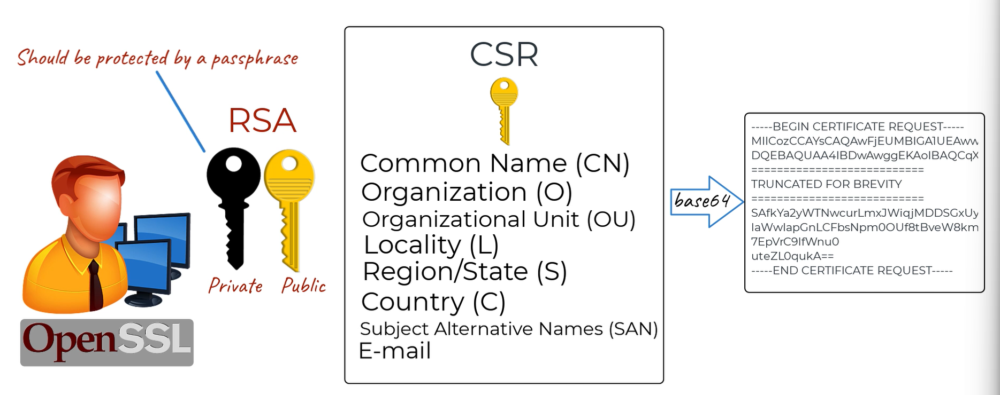
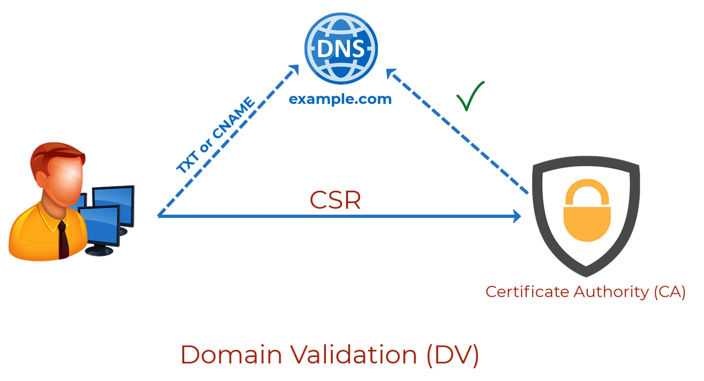
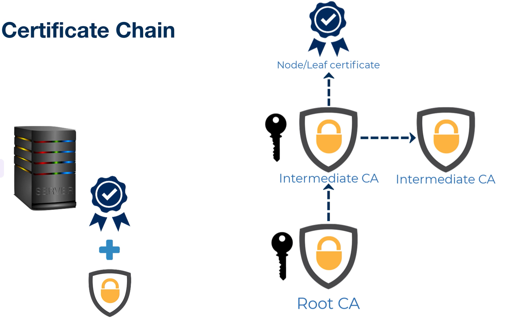

**Certificate Sign Request**

**Domain Validation request by CA**

Following the domain or email validation, the CA will hash the contents of the CSR, which is essentially the server's information and server's public key, and certify the CSR, by signing the hash of the CSR contents with its private key, known as digital signatures.

Upon receipt of the certificate by the server, the browser will again generate a hash of the certificate contents, then use the CA's public key to generate the digital signature, if the contents of the certificate hasn't changed, the two digital signatures (attached in the certificate, and generated by the browser) will match, allowing the browser to proceed to establish a secure connection with the server.

**Chain of certificates**
